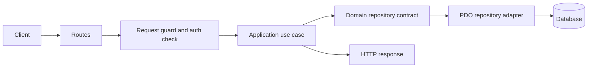
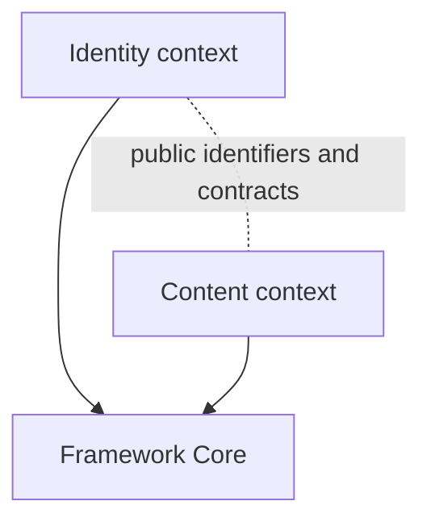

# PHPenalva

PHPenalva is a PHP application framework organized around HTTP entry points, bounded contexts, and PDO persistence.

## Table of Contents

1. [Architecture Overview](#architecture-overview)
2. [Installation](#installation)
3. [Key Features](#key-features)
4. [Technology Stack](#technology-stack)
5. [Project Structure](#project-structure)
6. [Usage Recipes](#usage-recipes)
7. [Testing](#testing)
8. [Best Practices](#best-practices)
9. [Commit Conventions](#commit-conventions)
10. [Code Standards](#code-standards)
11. [Documentation](#documentation)

## Architecture Overview

`App\Identity` owns user registration, deletion, and session authentication. `App\Content` owns posts. `Core` contains framework-level HTTP, database, session, and migration facilities; it does not depend on application contexts.






`bootstrap/dependencies.php` creates adapters and use cases. `bootstrap/Routes.php` resolves route declarations to controllers and dependencies. Controllers handle HTTP input/output and delegate writes to application use cases.

## Installation

1. Clone the repository and enter the project directory:

   ```sh
   git clone https://github.com/yanpenalva/phpenalva.git
   cd phpenalva
   ```

2. Install PHP dependencies and create the environment file:

   ```sh
   composer install
   cp .env.example .env
   ```

3. Select a PDO driver in `.env`. SQLite is the default; `DB_DATABASE` can point to a SQLite file. MySQL, PostgreSQL, and SQL Server have declared driver-specific migration DDL. Install the matching PDO extension and set `DB_HOST`, `DB_PORT`, `DB_DATABASE`, `DB_USERNAME`, and `DB_PASSWORD` for server databases.

4. Start the Docker Compose development environment when Docker is available:

   ```sh
   composer start
   ```

   The web server is exposed at `http://localhost:8081`. Stop the containers with `composer stop`.

5. Apply registered migrations:

   ```sh
   composer migrate
   ```

   The migration command defaults to `up`. Destructive rollback commands require `--force`; see [Installation and migrations](docs/01-installation.md#migrations).

## Key Features

- Identity and Content bounded contexts with Domain, Application, and Infrastructure layers.
- Session-cookie authentication, CSRF protection, and account/IP keyed login throttling.
- PDO repositories with explicit database-row mapping.
- Registered, dependency-ordered schema migrations with `up`, `down`, and latest-only `rollback` operations.
- JSON response envelope: `{status, message, data, errors}`.
- PHPUnit feature and unit suites.

## Technology Stack

| Area | Technology |
|---|---|
| Runtime | PHP 8.0+ |
| Dependencies | Composer, `vlucas/phpdotenv` |
| Persistence | PDO; SQLite, MySQL, PostgreSQL, and SQL Server driver declarations |
| HTTP development environment | Docker Compose, PHP and Nginx |
| Tests | PHPUnit 9.6+ |
| Static analysis | PHPStan 1.12+ |

SQLite is exercised by the automated HTTP, repository, and migration tests. Other drivers have per-driver DDL in the migration classes and are declared supported by configuration and migration code.

## Project Structure

```text
app/Identity/       Identity domain, use cases, and persistence adapters
app/Content/        Content domain, use cases, and persistence adapters
app/Controllers/    HTTP controllers
app/Middleware/     Request and CSRF guards
bootstrap/          Dependency factories and route dispatch
config/             Database and migration command configuration
core/               Framework services, database, and migration manager
database/migrations Registered schema migrations
docs/               Installation, architecture, recipes, and module references
routes/             HTTP route declarations
tests/              Feature and unit tests
```

## Usage Recipes

The commands below run from the repository root.

### Create a bounded context

```sh
mkdir -p app/Billing/{Domain,Application,Infrastructure/Persistence}
```

Add domain types and repository contracts under `app/Billing/Domain/`, use cases under `app/Billing/Application/`, and PDO adapters under `app/Billing/Infrastructure/Persistence/`. Register factories in `bootstrap/dependencies.php`. Keep the domain independent of `Core`, controllers, sessions, and PDO.

### Add a use case

Create `app/Content/Application/ArchivePost.php`, declare `strict_types=1`, inject the `PostRepository` contract, and expose the operation through `execute(...)`. Add focused tests under `tests/Unit/Content/ContentTest.php`, register a factory in `bootstrap/dependencies.php`, and update `docs/modules/content.md`.

### Add a value object

Create `app/Content/Domain/PostTitle.php`. Validate and normalize input in the constructor and expose it through a typed method. Add valid, invalid, and boundary cases to `tests/Unit/Content/ContentTest.php`.

### Expose an endpoint

1. Add the HTTP action to `app/Controllers/PostController.php`; guard and validate the request and delegate writes to a use case.
2. Declare the method and path in `routes/routes.php`.
3. Add required factories in `bootstrap/dependencies.php` and add the controller dependency mapping in `bootstrap/Routes.php`.
4. Verify the response contract in `tests/Feature/HttpContractTest.php`.
5. Update `docs/modules/content.md` with the endpoint and behavior.

HTTP mutations require the session CSRF token. Fetch it from `GET /csrf-token`, retain the session cookie, then send `X-CSRF-Token` with the mutation. Authentication uses session cookies; the API does not use Bearer tokens.

## Testing

Run the project checks from the repository root:

```sh
composer test
composer lint
composer analyse
```

- `composer test` runs PHPUnit. `tests/Unit/Identity/IdentityTest.php` and `tests/Unit/Content/ContentTest.php` cover context rules and persistence behavior.
- `tests/Feature/HttpContractTest.php` exercises the HTTP server, session/CSRF flow, JSON envelope, registration, authentication, and post operations using temporary SQLite databases.
- `tests/Feature/MigrationManagerTest.php` checks SQLite migration and rollback behavior; it also checks declared MySQL, PostgreSQL, and SQL Server DDL through a recording PDO double.
- `composer lint` runs `php -l` on the configured PHP file list.
- `composer analyse` runs PHPStan with `phpstan.neon`.

## Best Practices

- Keep domain code independent from HTTP, framework core, and persistence details.
- Use application use cases for state-changing behavior and repository contracts for persistence.
- Keep controllers focused on HTTP parsing, guards, response codes, and delegation.
- Bind SQL parameters and map rows explicitly in infrastructure adapters.
- Preserve the response envelope and meaningful status codes; successful `DELETE` responses may use `204` with no body.
- Use a shared storage service if login-attempt state must span machines. The configured file store is local to a machine and uses file locking for cooperating local processes.
- Review schema changes and take a separate backup before destructive rollback.

## Commit Conventions

Use Conventional Commit types with a concise imperative description:

```text
<type>: <description>
```

Common types: `feat`, `fix`, `docs`, `refactor`, `test`, `perf`, `build`, `ci`, `ops`, `chore`, `revert`.

## Code Standards

- Start PHP files with `declare(strict_types=1);` and use explicit types.
- Prefer guard clauses and linear control flow; do not add `else`/`elseif` branches.
- Keep files below 500 lines, methods below 150 lines, and methods to at most 15 declarations; target methods under 30 lines.
- Keep methods to at most 3 returns, 7 parameters, cyclomatic complexity 10, and cognitive complexity 15.
- Keep controllers thin, use cases focused, and SQL in persistence adapters.
- Add focused tests for behavior changes; the strict-code target is at least 80% coverage for new code.

## Documentation

- [Installation and migrations](docs/01-installation.md)
- [Architecture](docs/02-architecture.md)
- [Recipes](docs/03-recipes.md)
- [Identity module](docs/modules/identity.md)
- [Content module](docs/modules/content.md)
