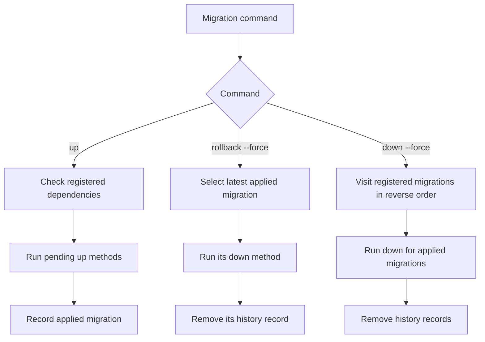

# Installation

## Requirements

PHP 8.0 or later, Composer, PDO, and the PDO extension for the selected database driver are required. A web server with URL rewriting is used by the provided development setup.

```sh
composer install
cp .env.example .env
```

## Database configuration

The default connection is SQLite at `database/database.sqlite`. Set `DB_CONNECTION` to `sqlite`, `mysql`, `pgsql`, or `sqlsrv`. Server connections use `DB_HOST`, `DB_PORT`, `DB_DATABASE`, `DB_USERNAME`, and `DB_PASSWORD`. The selected PDO driver must be installed. SQL Server also requires `pdo_sqlsrv`.

The configuration and migrations contain driver-specific DDL for SQLite, MySQL, PostgreSQL, and SQL Server. SQLite is exercised by live local automated tests; MySQL, PostgreSQL, and SQL Server are declared-supported through their PDO configuration and migration DDL.

## Migrations

Registered migrations are declared in `core/MigrationManager.php`; migration files are not discovered automatically. Apply pending migrations with:

```sh
composer migrate
```

The command accepts `up` (default), `down`, or `rollback` (latest applied migration only). Both rollback operations require explicit `--force`:

```sh
php config/migrate.php rollback --force
php config/migrate.php down --force
```

`down` drops all registered schema objects in reverse dependency order; `rollback` drops only the latest applied migration. These operations remove data in the affected tables. Arrange an independent backup before running them.



## Development environment

The Compose file is `.docker/docker-compose.yaml`. Start and stop it through Composer scripts:

```sh
composer start
composer stop
```

The Nginx service publishes port `8081` on the host. The Compose file defines the PHP application and web server; database configuration is supplied separately through `.env`.

## Authentication requests

Authentication uses a session cookie. Fetch a CSRF token from `GET /csrf-token`, keep the returned session cookie, and provide `X-CSRF-Token` on mutating requests, including registration and login. Credentials and post descriptions are read from request bodies, not query parameters. JSON and form bodies are accepted where parsed by `BaseRequest`.

## Login throttling

`FileAttemptStore` stores attempt timestamps in files and locks access with `flock`. Attempts are keyed by account and client address. The limiter allows five recorded failures in a 900-second window and clears the key after successful authentication. File storage is shared by cooperating processes on the same machine when they use the same filesystem; it does not provide cross-machine coordination. Storage I/O failures fail open.

## Local checks

```sh
composer test
composer lint
composer analyse
```
