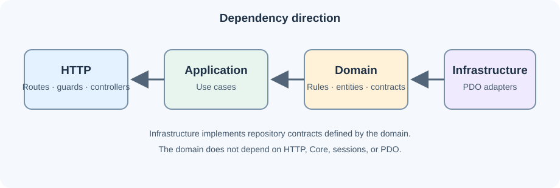
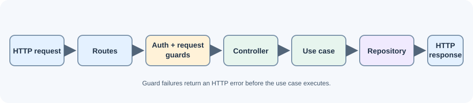
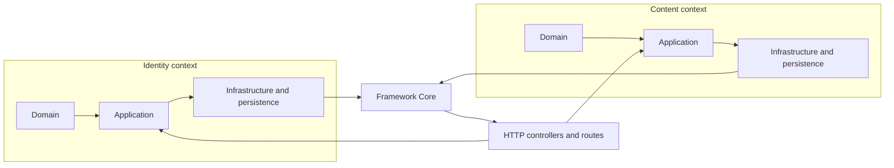
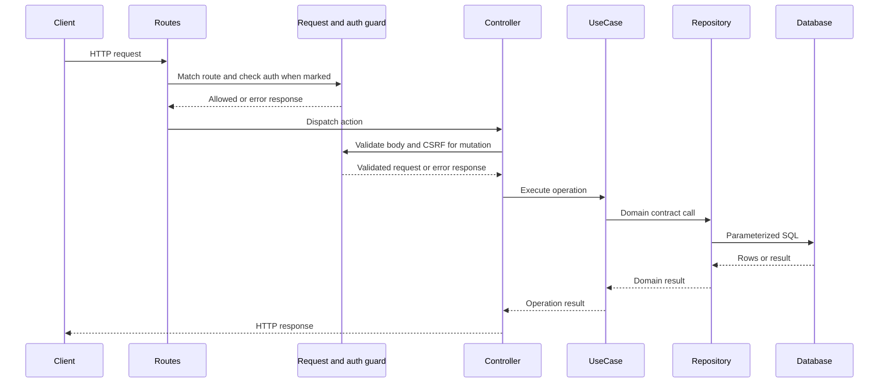
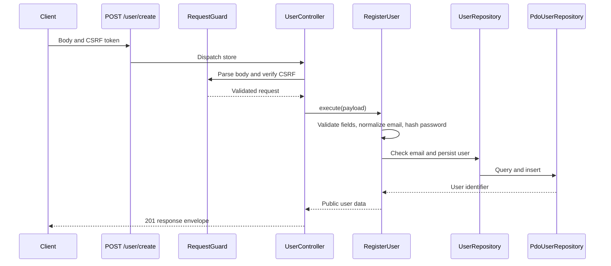

# Architecture

## Bounded contexts and layers

`App\Identity` owns user registration, deletion, and session authentication. `App\Content` owns post behavior. Each context separates `Domain`, `Application`, and `Infrastructure\Persistence`. `Core` contains framework-level HTTP, session, database, and migration facilities.

The domain defines repository contracts and business types. Application use cases coordinate domain behavior. Infrastructure implements repository contracts using PDO. Controllers depend on use cases for writes; read-oriented presentation can use repository contracts. `bootstrap/dependencies.php` composes adapters and use cases.

## Dependency rules

- Domain depends on PHP and types from its own domain.
- Application depends on domain contracts and coordinates use cases; it does not access HTTP or SQL.
- Infrastructure implements domain contracts and owns SQL mapping.
- Controllers handle HTTP input, guards, and output; state-changing operations delegate to use cases.
- Bootstrap constructs adapters and injects dependencies.
- `Core` does not reference `App` namespaces. Framework authentication depends on `Core\CredentialLookup`, implemented by the Identity persistence adapter.
- A context does not load another context's internal entities or repositories. Cross-context references use identifiers or public contracts.

## HTTP lifecycle

Routes in `routes/routes.php` are matched and mapped to a controller by `bootstrap/Routes.php`. Protected routes check session authentication. Controllers and `RequestGuard` validate the request and CSRF token before a use case is called. Repository contracts lead to PDO adapters; the controller formats the response.

## User registration sequence

## Persistence and schema

`users.email` is unique. `posts.user_id` is nullable; its MySQL, PostgreSQL, and SQL Server DDL specifies `ON DELETE SET NULL`. SQLite DDL declares the foreign key. Migrations are explicitly registered and dependency ordered in `core/MigrationManager.php`. SQLite migration behavior is covered by live automated tests; the other listed drivers have declared driver-specific DDL.

## Authentication and responses

Authentication is session-cookie based. Mutating requests require CSRF validation. Invalid credentials return a generic `401`; throttled login returns `429`. JSON responses use `{status, message, data, errors}`. Successful DELETE responses use `204` without a body.

## Project conventions

PHP source files begin with `declare(strict_types=1);` and use explicit types. Controllers handle HTTP parsing and output while use cases own application behavior and persistence adapters own SQL. Commit subjects follow `<type>: <description>` with Conventional Commit types such as `feat`, `fix`, `docs`, `refactor`, and `test`.
